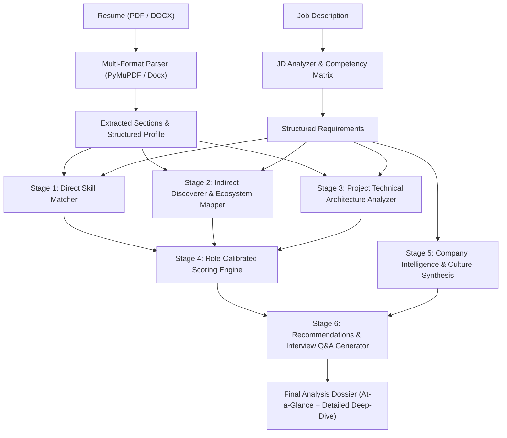

# AI Resume Analyzer

<p align="center">
  <strong>Evidence-Based Hiring Intelligence & Deterministic Resume Scoring</strong>
</p>

<p align="center">
  <a href="#features">Features</a> •
  <a href="#quick-start">Quick Start</a> •
  <a href="#architecture">Architecture</a> •
  <a href="#tech-stack">Tech Stack</a> •
  <a href="#evaluation-methodology">HR Methodology</a> •
  <a href="#api-reference">API Reference</a>
</p>

<p align="center">
  
  
  
  
  
  
  
</p>

---

## Overview

Traditional Applicant Tracking Systems (ATS) rely on superficial keyword matching. They reward keyword stuffing and unfairly reject high-potential candidates who demonstrate deep technical competency in their projects rather than spamming lists of buzzwords.

**AI Resume Analyzer** reimagines resume screening with **evidence-based technical analysis** and **real HR evaluation logic**:

- **No Opaque AI Hallucinations**: Every match, deduction, and score is computed deterministically through a transparent, 6-dimension weighted formula backed by exact excerpts from the resume.
- **Humanized HR Intelligence**: Differentiates between **Freshers / Early-Career** and **Experienced / Senior** roles—evaluating foundational potential and projects without demanding multi-year commercial history from junior engineers.
- **Skill Inventory Respect**: Skills stated in the candidate's skills section are credited as confirmed competencies rather than flagged as false skills.
- **Company & Hiring Culture Intelligence**: Automatically synthesizes work culture ratings, review sentiments (Glassdoor/Blind), and interview formats for target employers.

---

## Key Features

### 1. Real HR Evaluation & Role Calibration
- **Adaptive Level Scoring**: Automatically detects role seniority (`fresher`, `intern`, `junior`, vs `senior`, `lead`).
  - **Junior / Fresher**: Prioritizes demonstrated project depth, technical curiosity, coursework, and declared competencies (8.0+/10 reachable with strong projects).
  - **Senior / Lead**: Weights architectural trade-offs, commercial tenure, scalability, and system ownership.
- **Declared Skill Honor**: Recognizes declared skills in the skills inventory with high standing, avoiding false-skill penalties when a skill wasn't explicitly repeated in project bullets.

### 2. Intelligent Technical Deductions & Ecosystem Inference
- **Deductive Stack Reasoning**: If a project mentions *"built a responsive web app"*, the engine intelligently credits foundational **HTML, CSS, and JavaScript**.
- **Framework Ecosystem Mapping**: Using `React` automatically infers practical capability in **JavaScript, HTML, CSS, and Component Architecture**.
- **Domain Archetype Synthesis**: Clusters individual skills into broad disciplines (**Frontend Engineering**, **Backend Engineering**, **AI / ML Engineering**).
- **AI Project Recognition**: Any machine learning or neural network project automatically credits **AI Engineering** requirements even if omitted from the raw skills list.

### 3. Company & Hiring Culture Briefings
When a target company is specified (e.g., Google, Vercel, Stripe, Amazon, or custom startups), the analysis surfaces:
- **Work Culture Rating** (e.g., 4.4 / 5.0) and engineering velocity summary.
- **Interview & Hiring Style** (DSA rounds, take-home projects, system design, behavioral format).
- **Candidate Tips**: Direct advice on what hiring managers at that company look for.
- **Employee Sentiments**: Aggregated positive highlights and cautionary notes.

### 4. Dual Workspace Experiences
- **For Candidates**:
  - Track alignment across target roles.
  - Plain-English strengths and missing skill breakdowns.
  - Evidence-backed interview questions tailored to their specific gaps.
  - **One-Click Resume & ATS Optimizer** *(preview mode)*.
- **For Recruiters**:
  - Centralized candidate evaluation pipeline.
  - Standardized multi-candidate comparison tables.
  - Objective shortlisting and review workflow.

### 5. At-a-Glance Summary + Expandable Technical Deep-Dive
- **At-a-Glance Executive View** (Default): Instant HR score ring, confirmed competency badges, company culture brief, and plain-English strengths/gaps.
- **Detailed Technical View**: Full 8-tab matrix inspecting raw text excerpts, confidence ratings, project architecture evaluations, and custom interview prompts.

---

## Architecture & Pipeline Flow



---

## Tech Stack

| Layer | Technologies |
| :--- | :--- |
| **Frontend** | React 19, TypeScript, Vite, Tailwind CSS v4, Lucide Icons, Recharts |
| **Backend** | Python 3.10+, FastAPI, Uvicorn, Pydantic v2 |
| **Document Parsing** | PyMuPDF (fitz), python-docx |
| **Persistence** | SQLite with structured JSON serialization |
| **Authentication** | JWT (JSON Web Tokens) with Argon2/PBKDF2 hashing |
| **Testing** | Pytest, HTTPX TestClient (13/13 unit and integration tests passing) |

---

## Quick Start

### Prerequisites
- **Node.js** (v18 or higher)
- **Python** (v3.10 or higher)
- **Git**

### One-Command Setup & Launch

1. **Clone the repository:**
   ```bash
   git clone https://github.com/Bilal-x/resume-analyser.git
   cd resume-analyser
   ```

2. **Install dependencies:**
   ```bash
   npm install
   ```
   > Automatically sets up root orchestration tools and installs frontend packages.

3. **Install Python backend dependencies:**
   ```bash
   pip install -r backend/requirements.txt
   ```
   *(Or install core dependencies directly: `pip install fastapi uvicorn pymupdf python-docx pytest httpx pydantic`)*

4. **Start the application:**
   ```bash
   npm run dev
   ```

Both servers will launch simultaneously:
- **Frontend UI**: [http://localhost:5173](http://localhost:5173)
- **Backend API**: [http://localhost:8000](http://localhost:8000)
- **Interactive Swagger Docs**: [http://localhost:8000/api/docs](http://localhost:8000/api/docs)

---

## Available Scripts

| Command | Description |
| :--- | :--- |
| `npm run dev` | Starts FastAPI backend and React frontend concurrently |
| `npm run dev:backend` | Runs only the FastAPI server with auto-reload |
| `npm run dev:frontend` | Runs only the Vite dev server |
| `npm run test:backend` | Executes the 13-test automated pytest suite |
| `npm run build` | Compiles the production React bundle with Tailwind v4 |
| `npm run lint` | Runs the oxlint linter across frontend files |

---

## Evaluation Methodology & Scoring Formula

The overall match score (out of 10.0) is strictly deterministic and auditable:

$$\text{Overall Score} = 10 \times \sum_{i=1}^{n} (\text{Dimension Score}_i \times \text{Dimension Weight}_i)$$

### Dimension Weights (Adaptive Calibration)

| Dimension | Experienced Role | Fresher / Junior Role | Real HR Evaluation Criteria |
| :--- | :---: | :---: | :--- |
| **Mandatory Skills** | **30%** | **25%** | Verifies declared competencies and direct evidence |
| **Core Technical Skills** | **25%** | **30%** | Assesses broad foundation and technical literacy |
| **Project Relevance & Depth** | **25%** | **35%** | Rewards hands-on implementations and architecture |
| **Relevant Experience** | **20%** | **10%** | Evaluates professional tenure or academic projects |

---

## Project Structure

```
resume-analyser/
├── backend/
│   ├── app/
│   │   ├── main.py                   # FastAPI entrypoint & middleware
│   │   ├── database.py               # SQLite schema & connection pooling
│   │   ├── auth.py                   # JWT security & role-based guards
│   │   ├── models/schemas.py         # Pydantic data schemas
│   │   ├── routers/                  # REST endpoints (auth, resumes, jds, analyses)
│   │   └── services/
│   │       ├── analysis_pipeline.py  # Multi-stage evaluation coordinator
│   │       ├── direct_matcher.py     # Skills inventory & experience matching
│   │       ├── indirect_discoverer.py# Technical deductions & domain synthesis
│   │       ├── scoring_engine.py     # HR role calibration & scoring logic
│   │       ├── skill_taxonomy.py     # Typo normalization & ecosystem maps
│   │       ├── company_intelligence.py# Culture, reviews & interview insights
│   │       ├── project_analyzer.py   # Project architecture inspector
│   │       ├── recommendation_engine.py# Resume bullet rewrite generator
│   │       └── interview_generator.py # Tailored interview Q&A engine
│   └── tests/                        # Automated pytest test suites
└── frontend/
    ├── src/
    │   ├── components/               # Layout, Sidebar, Minimal UI system
    │   ├── contexts/                 # AuthContext & token management
    │   ├── lib/api.ts                # Type-safe API client
    │   └── pages/
    │       ├── LandingPage.tsx       # Minimalist, humanized landing page
    │       ├── CandidateDashboard.tsx# Candidate portal with ATS optimizer
    │       ├── RecruiterDashboard.tsx# Recruiter pipeline & shortlist tools
    │       ├── AnalysisDetailPage.tsx# At-a-glance & technical deep-dive
    │       ├── CandidateComparisonPage.tsx# Multi-candidate matrix comparison
    │       ├── ResumesPage.tsx       # Resume upload & parsing manager
    │       └── JDsPage.tsx           # Job description requirement manager
```

---

## License

This project is licensed under the [MIT License](LICENSE).
